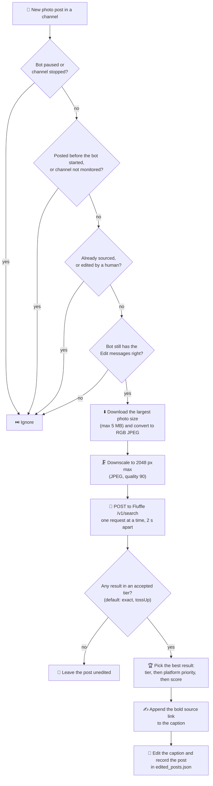
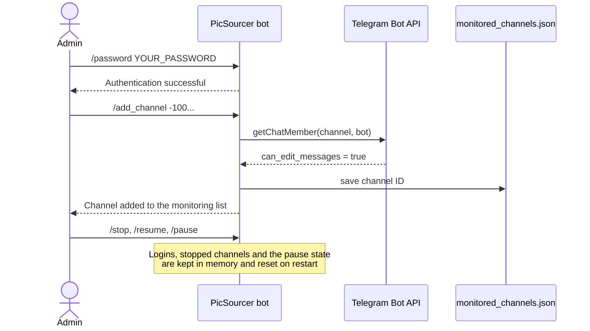

<div align="center">

# PicSourcer

**Automatic artist credit for Telegram channels, powered by Fluffle reverse-image search.**

[](https://www.python.org/)
[](https://python-telegram-bot.org/)
[](https://docs.aiohttp.org/)
[](https://fluffle.xyz)
[](Dockerfile)
[](https://github.com/uasneppy/PicSourcer/commits/main)

[Quick start](#-getting-started) · [Commands](#commands) · [Configuration](#-configuration) · [FAQ](#-troubleshooting--faq)

</div>

---

PicSourcer is a Telegram bot for channel owners who repost art and want to credit the artist properly. Add it to your channel as an admin and it watches for new photo posts. For each one it reverse-searches the image with [Fluffle](https://fluffle.xyz), picks the most reliable match, and edits the post's caption to add a link to the original, credited to the artist when Fluffle knows who that is. You don't have to search for sources or paste links by hand.

> [!NOTE]
> Inside Telegram the bot calls itself **Source Bot**: that name appears in its log output (`SourceBot`), its class name, and its help text.

## Table of contents

- [✨ Features](#-features)
- [🧭 How it works](#-how-it-works)
- [🧰 Tech stack](#-tech-stack)
- [🚀 Getting started](#-getting-started)
- [🔧 Configuration](#-configuration)
- [🎮 Usage](#-usage)
- [🌐 Supported platforms](#-supported-platforms)
- [📂 Project structure](#-project-structure)
- [🩺 Troubleshooting & FAQ](#-troubleshooting--faq)
- [🙏 Credits](#-credits)

## ✨ Features

**🔍 Automatic sourcing**
- Picks up every new photo post in the channels it monitors
- Reverse-searches the highest-resolution version of each photo with the Fluffle API
- Adds a bold, clickable source link under the existing caption: **by Artist**, or **on Platform** when Fluffle has no artist name

**🎯 Careful match selection**
- Only trusts the Fluffle confidence tiers you allow (`exact` and `tossUp` by default)
- Breaks ties by platform (e621 first, because its artist data is the most complete), then by Fluffle's similarity score
- Cleans up artist credits: strips e621's `_(artist)` suffix, drops meta tags such as `unknown_artist` or `ai_generated`, and removes duplicates

**🤝 Leaves your edits alone**
- Ignores posts published before the bot started
- Never edits a post twice. Sourced posts are recorded in `edited_posts.json`, which survives restarts
- Skips any post you edit by hand, including one you edit while its search is still running
- If no confident match is found, the post is left unchanged

**📡 Channel management**
- Add and remove channels from Telegram; the list is saved to `monitored_channels.json`
- Before a channel is added, the bot checks that it has the **Edit messages** right there
- Stop or resume a single channel, or pause and resume everything at once
- `/list_channels` shows each channel's title, ID and 🟢/🔴 status

**🔒 Access control**
- Every management command requires `/password` first

**🛡️ Fluffle-friendly networking**
- Sends one request at a time, at least 2 seconds apart, as Fluffle's one-concurrent-request rule requires
- Makes up to 3 attempts, waiting 2 s and then 4 s, on HTTP 429, 500 and 503 responses, timeouts and network errors
- Shrinks images to at most 2048 px on the longest edge by default, to stay under Fluffle's 4 MiB / 16 MP limits
- Sends a User-Agent that identifies your app, which Fluffle requires

**📦 Deployment options**
- Run it directly, as a **systemd** service (installer script included), or in **Docker**

## 🧭 How it works

### The sourcing pipeline



What the edited caption looks like:

```text
Fresh commission for the weekend! 🎨

by ArtistName            ← bold, links to the original post
```

| Situation | Link text added under the caption |
| --- | --- |
| Fluffle returns artist credits | **by Name1, Name2** |
| No usable credits | **on e621**, **on Fur Affinity**, … (the platform's name) |
| A Bluesky match with no credits | **Автор на Bluesky 💎** (Ukrainian for "Author on Bluesky") |

### Authentication and channel management



## 🧰 Tech stack

| Layer | Technology |
| --- | --- |
| Language | Python 3.11+ ([`pyproject.toml`](pyproject.toml)); the Docker image uses 3.12 |
| Telegram | [python-telegram-bot](https://python-telegram-bot.org/) ≥ 21.10 (asyncio, long polling) |
| HTTP | [aiohttp](https://docs.aiohttp.org/) ≥ 3.11.12, used for Fluffle requests and Telegram file downloads |
| Images | [Pillow](https://python-pillow.org/) ≥ 11.1, used to convert to RGB, resize and re-encode as JPEG |
| Configuration | [python-dotenv](https://github.com/theskumar/python-dotenv) ≥ 1.0.1, which loads `.env` automatically |
| Reverse search | [Fluffle](https://fluffle.xyz) HTTP API (`/v1/search`) |
| Deployment | Docker (`python:3.12-slim`), systemd, Replit config (`.replit`) |

## 🚀 Getting started

### Prerequisites

- A machine that stays online, such as a VPS or cloud server (Debian/Ubuntu steps below), or any host with Docker
- **Python 3.11+** and **git**
- A **bot token** from [@BotFather](https://t.me/BotFather). That is the only Telegram credential you need: there is no `api_id`/`api_hash` and no user-account session.
- A Telegram **channel** where you can add admins
- No Fluffle API key: the API is public, and you only need to identify yourself with a User-Agent

### 1. Create the bot and add it to your channel

1. Send `/newbot` to [@BotFather](https://t.me/BotFather) and copy the token it gives you.
2. Add the bot to your channel as an **administrator** with the **Edit messages of others** right (`can_edit_messages` in the Bot API).
3. Find the channel ID. It starts with `-100`, and the bot suggests forwarding a channel post to [@userinfobot](https://t.me/userinfobot) to get it.

### 2. Install (Debian / Ubuntu)

```bash
sudo apt update && sudo apt install -y git python3 python3-venv
git clone https://github.com/uasneppy/PicSourcer.git
cd PicSourcer
python3 -m venv venv
source venv/bin/activate
pip install -r requirements.txt
```

> [!TIP]
> Name the virtual environment `venv` and put it in the project folder. The systemd unit expects the interpreter at `venv/bin/python`.

### 3. Configure

Create a `.env` file in the project folder. The bot loads it automatically.

```dotenv
# Required
TELEGRAM_BOT_TOKEN=123456789:replace-with-your-bot-token
BOT_PASSWORD=choose-a-long-random-password

# Where monitored_channels.json is stored. The default (/data) only works as root.
DATA_DIR=./data

# Identify your app to Fluffle (quote any value that contains spaces)
FLUFFLE_USER_AGENT="MyChannelSourcer/1.0 (by your-name on Telegram)"

# Optional tuning (see the Configuration section)
# LOG_LEVEL=INFO
# FLUFFLE_INCLUDE_NSFW=true
# FLUFFLE_ACCEPTED_MATCHES=exact,tossUp
# FLUFFLE_PLATFORMS="e621,Fur Affinity,Twitter"
```

> [!IMPORTANT]
> **Set `BOT_PASSWORD`.** It's the password admins send with `/password` to manage the bot. There is no default: if it's empty or unset, nobody can log in, and the bot logs a warning on startup. Use a long random value, for example from `openssl rand -base64 24`.

### 4. Run

<details open>
<summary><b>Option A: in the foreground</b> (for testing)</summary>

```bash
source venv/bin/activate
python bot.py
```

Run it from the project folder: `DATA_DIR=./data`, `edited_posts.json` and `bot.log` are all relative to the working directory.

</details>

<details>
<summary><b>Option B: as a systemd service</b> (recommended for servers)</summary>

```bash
sudo bash install_service.sh
```

The installer:

1. checks that `.env` exists and defines `TELEGRAM_BOT_TOKEN`
2. stops and disables any existing `telegram_bot` service
3. fills in the project path in [`telegram_bot.service`](telegram_bot.service) and installs it to `/etc/systemd/system/`
4. enables and starts the service, then prints its status

The unit runs `venv/bin/python bot.py` from the project folder, loads `.env` through `EnvironmentFile`, and restarts the bot 10 s after any exit. It sets no `User=`, so the bot runs as root.

```bash
sudo systemctl status telegram_bot      # check status
sudo systemctl restart telegram_bot     # restart after changing .env or bot.py
sudo journalctl -u telegram_bot -f      # follow the logs
```

</details>

<details>
<summary><b>Option C: with Docker</b></summary>

`.env` is not copied into the image (it's listed in `.dockerignore`), so pass it at runtime, including `BOT_PASSWORD`:

```bash
docker build -t picsourcer .
docker run -d --name picsourcer \
  --env-file .env \
  -v picsourcer-data:/data \
  --restart unless-stopped \
  picsourcer
```

> [!WARNING]
> `docker run --env-file` keeps quotes as part of the value, so leave values **unquoted** in the file you pass to Docker. Also leave `DATA_DIR` unset there (it defaults to `/data`, the mounted volume).

By default, `edited_posts.json` and `bot.log` are written to the container's working directory (`/app`), not to the volume. To keep them on the volume as well, run from `/data`:

```bash
docker run -d --name picsourcer --env-file .env \
  -v picsourcer-data:/data -w /data --restart unless-stopped \
  picsourcer python /app/bot.py
```

</details>

## 🔧 Configuration

Settings are read from environment variables in [`config.py`](config.py) (and `BOT_PASSWORD` in [`bot.py`](bot.py)). A `.env` file in the project folder is loaded automatically, but variables already set in the environment take precedence over it.

| Variable | Required | Default | Description |
| --- | :---: | --- | --- |
| `TELEGRAM_BOT_TOKEN` | ✅ | *(empty)* | Bot token from @BotFather. |
| `BOT_PASSWORD` | ✅ | *(empty)* | Password for `/password`. Read in [`bot.py`](bot.py). When empty, nobody can log in. |
| `DATA_DIR` | – | `/data` | Folder for `monitored_channels.json`. It's created on startup, so it must be writable: set it (for example `./data`) when you don't run as root. |
| `MONITORED_CHANNELS` | – | *(empty)* | Comma-separated starting list of channel IDs. Only used when `$DATA_DIR/monitored_channels.json` is missing or unreadable. |
| `LOG_LEVEL` | – | `DEBUG` | Python logging level, in uppercase: `DEBUG`, `INFO`, `WARNING`, `ERROR`. |
| `FLUFFLE_API_URL` | – | `https://api.fluffle.xyz/v1/search` | Fluffle search endpoint. |
| `FLUFFLE_USER_AGENT` | recommended | `PicSourcer/2.0 (by uasneppy on GitHub)` | The User-Agent Fluffle requires. Use the format `appName/version (by yourName on somePlatform)`. |
| `FLUFFLE_INCLUDE_NSFW` | – | `true` | Whether to include adult results. Only the value `true` (any letter case) turns it on. Most furry art and **all** Twitter/Bluesky results need it, because Fluffle marks every Twitter/Bluesky image as explicit. |
| `FLUFFLE_LIMIT` | – | `32` | How many candidate results Fluffle returns. Values outside 8–32 are clamped to that range. |
| `FLUFFLE_PLATFORMS` | – | *(empty = all)* | Comma-separated list of platforms to search. See [Supported platforms](#-supported-platforms). |
| `FLUFFLE_ACCEPTED_MATCHES` | – | `exact,tossUp` | Confidence tiers allowed to trigger a caption edit: `exact`, `tossUp`, `alternative`, `unlikely` (any letter case). |
| `FLUFFLE_TIMEOUT` | – | `30` | Timeout in seconds for each Fluffle request. |
| `FLUFFLE_MAX_DIMENSION` | – | `2048` | Images are shrunk to this many pixels on the longest edge before upload. |

<details>
<summary><b>Settings that are set in code</b></summary>

| Setting | Location | Value |
| --- | --- | --- |
| Max photo download size | `config.py`, `MAX_FILE_SIZE` | 5 MB |
| Minimum gap between Fluffle requests | `image_search.py`, `_MIN_SEARCH_INTERVAL` | 2.0 s |
| Fluffle retries | `image_search.py`, `_query_fluffle` | 3 attempts on 429/500/503, timeouts and network errors; 2 s → 4 s backoff; other errors (e.g. 400) are not retried |
| Confidence tier order | `config.py`, `MATCH_ORDER` | `exact` > `tossUp` > `alternative` > `unlikely` |
| Platform tie-break order | `config.py`, `PLATFORM_PRIORITY` | see [Supported platforms](#-supported-platforms) |
| e621 tags ignored as artist names | `config.py`, `META_ARTIST_TAGS` | `unknown_artist`, `anonymous_artist`, `avoid_posting`, `third-party_edit`, `sound_warning`, `epilepsy_warning`, `ai_generated`, `stable_diffusion`, `novelai` |
| Caption length cap | `bot.py`, `handle_channel_post` | captions longer than 1000 characters are cut to 997 + `...` before the link is added |

</details>

### Files written at runtime

| Path | Contents |
| --- | --- |
| `$DATA_DIR/monitored_channels.json` | JSON list of monitored channel IDs |
| `$DATA_DIR/logs/` | Created on startup but not used yet |
| `./edited_posts.json` | `channel_id:message_id` keys of posts that were sourced or edited by hand. These posts are never touched again. |
| `./bot.log` | Rotating log (1 MB per file, 5 backups), also printed to the console |
| `/tmp/telegram_bot.pid` | Process ID of the running bot, removed on shutdown |

`./` means the bot's working directory.

## 🎮 Usage

### Commands

| Command | Login needed | What it does |
| --- | :---: | --- |
| `/start` | – | Shows a welcome message and a short list of commands. |
| `/password <password>` | – | Logs in your Telegram account for this bot until the next restart. |
| `/add_channel <channel_id>` | 🔒 | Checks that the ID starts with `-100` and that the bot can edit messages in the channel, then starts monitoring it. |
| `/delete_channel <channel_id>` | 🔒 | Removes a channel from the monitoring list. |
| `/list_channels` | 🔒 | Lists monitored channels with their title, ID and status. |
| `/stop <channel_id>` | 🔒 | Stops editing posts in one monitored channel. |
| `/resume <channel_id>` | 🔒 | Resumes a channel stopped with `/stop`. |
| `/pause` | 🔒 | Turns processing on or off for **all** channels. |
| `/help` | 🔒 | Sends the built-in help text (see [known limitations](#known-limitations)). |

### Typical flow

1. **Log in.** Message your bot privately and send `/password <password>`.
2. **Add a channel.** Send `/add_channel -100XXXXXXXXXX`. The bot confirms once it has checked its admin rights.
3. **Post as usual.** Publish a photo in the channel. Shortly afterwards the caption gets a source link, if Fluffle finds a confident match.
4. **Manage channels.** Use `/list_channels` to check status, `/stop` and `/resume` for individual channels, and `/delete_channel` to remove one.
5. **Pause everything.** Send `/pause` to stop processing in every channel, and `/pause` again to resume.

### Channel status icons

| Icon | Status | Meaning |
| :---: | --- | --- |
| 🟢 | **Active** | The bot is sourcing new photo posts in this channel. |
| 🔴 | **Stopped** | The channel was stopped with `/stop`, so its posts aren't edited. |

> [!NOTE]
> Logins, `/stop` and `/pause` are kept in memory only. After a restart you need to log in again, and every monitored channel becomes 🟢 Active and unpaused.

## 🌐 Supported platforms

The bot can link to any platform Fluffle indexes. These eight have display names and a tie-break rank in [`config.py`](config.py):

| Rank | Platform | `FLUFFLE_PLATFORMS` value |
| :---: | --- | --- |
| 1 | e621 | `e621` |
| 2 | Fur Affinity | `Fur Affinity` |
| 3 | Weasyl | `Weasyl` |
| 4 | Inkbunny | `Inkbunny` |
| 5 | Furry Network | `Furry Network` |
| 6 | DeviantArt | `DeviantArt` |
| 7 | Twitter (X) | `Twitter` |
| 8 | Bluesky | `Bluesky` |

When two accepted results share the same confidence tier, the higher-ranked platform wins, and Fluffle's score decides the rest. A platform Fluffle adds later is still linked, but under its raw name and ranked last. Fluffle treats platform names case-insensitively ([API docs](https://fluffle.xyz/api/)), and an invalid name makes the request fail with HTTP 400.

## 📂 Project structure

```text
PicSourcer/
├── bot.py                   # Entry point: SourceBot class, commands, channel-post pipeline, caption editing
├── image_search.py          # Fluffle client: pacing, retries, result ranking, artist-credit cleanup
├── config.py                # Environment config, Fluffle tuning, platform tables, channel list storage
├── utils.py                 # Downloads Telegram photos and converts them to RGB JPEG
├── logger.py                # "SourceBot" logger: console output plus rotating bot.log
├── requirements.txt         # pip dependencies
├── pyproject.toml           # Project metadata (picsourcer 2.0.0, Python >= 3.11)
├── Dockerfile               # python:3.12-slim image that runs `python bot.py`
├── .dockerignore            # Keeps .env, venv, logs and caches out of the image
├── .gitignore               # Keeps .env, Telethon sessions, cookie exports, logs and runtime data out of git
├── telegram_bot.service     # systemd unit template (__WORKDIR__ is filled in by the installer)
├── install_service.sh       # Installs, enables and starts the systemd service
├── monitored_channels.json  # Empty placeholder; the live list is kept in $DATA_DIR
└── .replit                  # Replit workspace config
```

## 🩺 Troubleshooting & FAQ

| Symptom | Likely cause and fix |
| --- | --- |
| `PermissionError` or `Read-only file system` for `/data` at startup | The default `DATA_DIR` isn't writable. Set `DATA_DIR=./data` (or another writable path). |
| Crash in `logger.py` at startup (`TypeError` or `AttributeError`) | `LOG_LEVEL` must be an uppercase level name, such as `INFO`. |
| `install_service.sh` prints ``syntax error near unexpected token `('`` | A `.env` value with spaces or parentheses (usually `FLUFFLE_USER_AGENT`) isn't quoted. Wrap it in double quotes. |
| `/add_channel` replies *Invalid channel ID format* | Channel IDs start with `-100`. |
| `/add_channel` says the bot *lacks editing permissions* | Give the bot the **Edit messages of others** admin right in that channel. |
| `/add_channel` replies *Channel not found* or *Failed to add channel* | The ID is wrong, or the bot hasn't been added to the channel as an admin. |
| *You need to authenticate first!* after a restart | Logins are kept in memory. Send `/password` again. |
| Photo posts never get a source | Work through this checklist:<br/>• the channel shows 🟢 in `/list_channels`<br/>• `/pause` isn't switched on<br/>• the image was sent as a photo, not as a file<br/>• it was posted after the bot started<br/>• `FLUFFLE_INCLUDE_NSFW=true`<br/>• `FLUFFLE_ACCEPTED_MATCHES` isn't too strict<br/>Then set `LOG_LEVEL=DEBUG` and look in the log for `Fluffle found no sufficiently confident match`. |
| Log shows `Fluffle request failed (400)` | Check `FLUFFLE_PLATFORMS` for typos, and for literal quotes if you use Docker's `--env-file`. |
| Log shows `Fluffle rate-limited (429)` | The bot already retries. Make sure only one copy of the bot is running against Fluffle. |
| A post I edited by hand never got a source | This is intended: posts edited by hand are skipped and remembered in `edited_posts.json`. |

<details>
<summary><b>Frequently asked questions</b></summary>

**Does it change old posts?**
No. Only posts published after the bot starts are processed.

**What happens if no source is found?**
Nothing. The post stays exactly as it was.

**Who is the "by …" name?**
Whatever Fluffle lists as credits. On e621 these come from the artist tags. On other platforms it's usually the account that uploaded the image, which isn't always the artist.

**Is my caption formatting kept?**
Your caption's text is kept, but the bot rebuilds it from plain text, so Telegram formatting such as bold, italics, hidden text links or custom emoji is lost when the source is added. Markdown links typed literally as `[text](url)` are kept.

**What about albums or images sent as files?**
Only photos are processed. Telegram delivers each photo in an album as a separate message, so each one can get its own source link. Images sent as files (documents) are ignored.

**Can several people manage the bot?**
Yes. Anyone who knows the password can log in, and everyone shares the same channel list.

**Do I need a Fluffle account or API key?**
No. Fluffle only asks for an identifiable User-Agent and one request at a time, and the bot handles both.

</details>

### Known limitations

- There is one shared password (`BOT_PASSWORD`), compared as plain text. Logins, stopped channels and the pause state reset on restart.
- `/help` sends its text in MarkdownV2 mode without escaping reserved characters (`.`, `-`, `(` …), so Telegram may reject the message. The [command table](#commands) has the same information.
- The bot replaces Python's handlers for `SIGINT`, `SIGTERM` and `SIGHUP`, and those handlers only log the signal without stopping polling. As a result, `Ctrl+C`, `systemctl stop` and `docker stop` may only stop the bot once it is force-killed (after 30 s under the bundled systemd unit).
- The bot uses Fluffle's `/v1/search` endpoint, which Fluffle now calls legacy and doesn't recommend for new projects.

Need more help? [Open an issue](https://github.com/uasneppy/PicSourcer/issues).

## 🙏 Credits

- **[Fluffle](https://fluffle.xyz)** provides the reverse-image search for furry art that does the matching. Please follow its usage policy: set an identifiable `FLUFFLE_USER_AGENT` and send one request at a time.
- **[python-telegram-bot](https://python-telegram-bot.org/)**, **[aiohttp](https://docs.aiohttp.org/)**, **[Pillow](https://python-pillow.org/)** and **[python-dotenv](https://github.com/theskumar/python-dotenv)** are the libraries the bot is built on.

<div align="center">

<sub>Credit the artists whose work you share. 🎨</sub>

</div>
